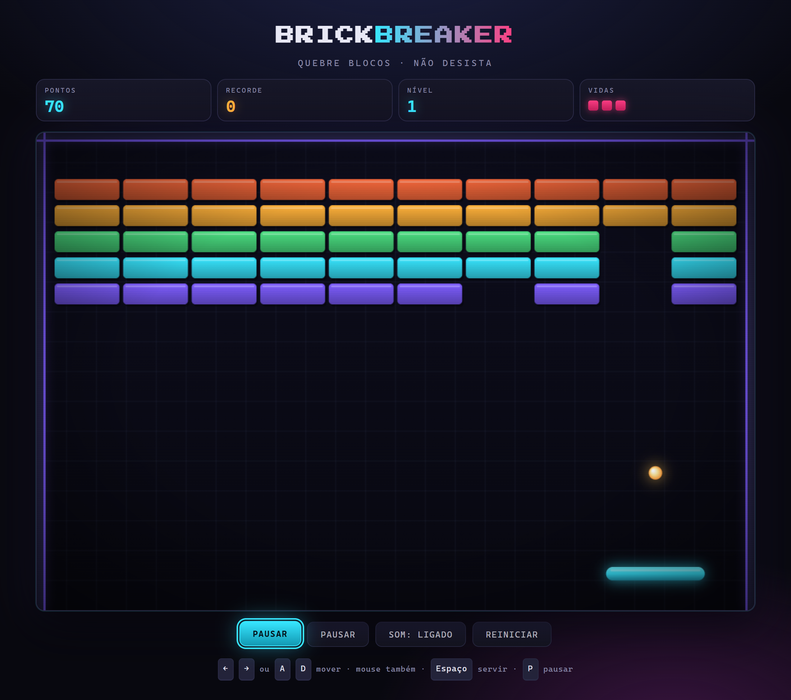
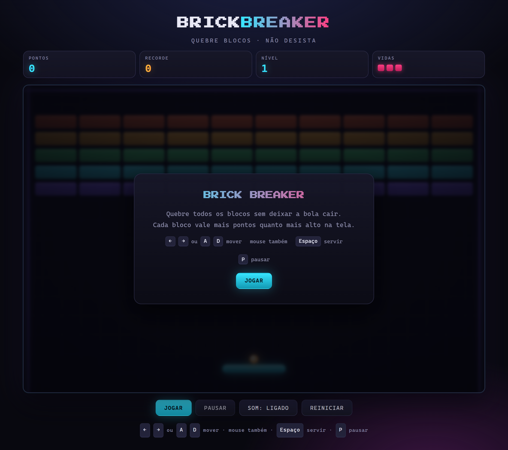

# 🧱 Brick Breaker — Arcade

<div align="center">
  
</div>

> 🚀 Meu **primeiro projeto no GitHub**! Um fliperama clássico de quebrar blocos, feito do zero
> com HTML, CSS e JavaScript puro — **sem frameworks, sem build, sem dependências**.

<div align="center">

[](https://__GITHUB_USERNAME__.github.io/brick-breaker-arcade/)
[](LICENSE)
[](src/)
[](https://__GITHUB_USERNAME__.github.io/brick-breaker-arcade/)

</div>

---

## 📖 Sobre o projeto

A ideia nasceu de querer **entender de verdade** como um jogo funciona por dentro: o loop de
animation, a física, a colisão, o estado, o desenho no canvas. Nada de copiar e colar — cada
linha foi escrita para entender o que ela faz.

O resultado é um fliperama completo e jogável no navegador, que roda em qualquer tela
(computador ou celular) e é publicado automaticamente pelo GitHub Pages.

### ✨ Recursos

- 🎯 **3 níveis** com layouts diferentes — *Primeira Fileira*, *Corredor* e *Pirâmide*
- 🛡️ **Blocos blindados** que aguentam dois golpes
- 🏅 **Recorde salvo no navegador** (`localStorage`), entre uma sessão e outra
- ⚡ **Velocidade progressiva** — a bola fica mais rápida a cada rebote
- 🎯 **Rebote angulado**: onde você acerta a raquete define para onde a bola vai
- 💥 **Partículas de explosão** quando os blocos estouram
- 🔊 **Efeitos sonoros sintetizados** com a Web Audio API (sem nenhum arquivo de áudio)
- 🖱️ **Controle por teclado, mouse ou toque**
- ⏸️ **Pausa automática** ao trocar de aba
- 📱 **Layout responsivo** — do celular ao monitor grande
- ♿ Respeita `prefers-reduced-motion` para quem tem preferências de acessibilidade

---

## 🎮 Como jogar

O objetivo é **destruir todos os blocos** de cada nível sem deixar a bola cair.
Cada bloco vale mais pontos quanto mais alto ele estiver na tela.

| Controle | Ação |
| :--- | :--- |
| <kbd>←</kbd> <kbd>→</kbd> ou <kbd>A</kbd> <kbd>D</kbd> | Mover a raquete |
| Mouse / toque | Mover a raquete |
| <kbd>Espaço</kbd> ou clique | Servir a bola |
| <kbd>P</kbd> ou <kbd>Esc</kbd> | Pausar / continuar |

<div align="center">
  
</div>

---

## 💻 Rodando localmente

O jogo usa **módulos ES** (`import` / `export`). Por isso o navegador **não consegue**
carregar os arquivos direto do disco (`file://`) — ele bloqueia por segurança. A solução é
servir a pasta por HTTP com qualquer um destes comandos:

```bash
# Opção 1 — Python (já vem instalado no Windows e no macOS)
python -m http.server 8000

# Opção 2 — Node.js
npx serve .

# Opção 3 — extensão "Live Server" do VS Code
```

Depois é só abrir **http://localhost:8000** no navegador.

> 💡 **No GitHub Pages o jogo funciona direto**, sem nenhum passo extra. O link do botão
> “Jogar agora” no topo já é a versão publicada.

---

## 🗂️ Estrutura do projeto

```
.
├── index.html              # página, HUD e telas de menu/pausa/fim de jogo
├── css/
│   └── style.css           # visual do "gabinete" de fliperama, responsividade
├── src/
│   ├── main.js             # ponto de entrada: liga o jogo à interface
│   ├── game.js             # regras, física, estados, pontuação e níveis
│   ├── input.js            # teclado, mouse e toque
│   ├── audio.js            # efeitos sonoros sintetizados (Web Audio API)
│   ├── particles.js        # sistema de partículas da explosão
│   ├── storage.js          # gravação do recorde no localStorage
│   └── entities/
│       ├── paddle.js       # a raquete do jogador
│       ├── ball.js         # a bola e o ângulo de rebote
│       └── bricks.js       # blocos, níveis e colisão
├── assets/                 # screenshots do README
├── .github/workflows/
│   └── pages.yml           # publicação automática no GitHub Pages
├── .gitignore
├── LICENSE
└── README.md
```

---

## 🧰 Tecnologias

| Tecnologia | Para quê |
| :--- | :--- |
| **HTML5 Canvas** | Desenho do jogo (bola, raquete, blocos, partículas) |
| **JavaScript (ES Modules)** | Toda a lógica do jogo |
| **CSS3** | Layout, efeitos visuais e responsividade |
| **Web Audio API** | Sons gerados por código, sem arquivos |
| **LocalStorage API** | Guarda do recorde |
| **GitHub Actions** | Deploy automático no GitHub Pages |

Sem `npm install`, sem bundler, sem framework. Você abre, joga, e pronto.

---

## 🔧 Como o jogo funciona por dentro

1. **`requestAnimationFrame`** mantém o loop: lê o tempo entre quadros, atualiza a lógica e
   redesenha a tela.
2. A bola é movida em **sub-passos pequenos** (no máximo 6 px por passo) — é isso que impede
   a bola de “atravessar” os blocos quando está rápida.
3. Toda colisão entre **círculo e retângulo** é resolvida pela normal do ponto de contato.
   No paddle, essa normal é calculada a partir de **onde** você acertou, o que dá o
   comportamento clássico do fliperama.
4. O jogo é uma **máquina de estados** (`menu`, `playing`, `paused`, `level-clear`,
   `game-over`, `victory`). Cada transição chama `emit()`, que atualiza o HUD e a tela
   de overlay.

---

## 🗺️ Próximos passos

- [ ] Mais níveis, com dificuldade crescente
- [ ] Blocos de power (bola mais rápida, raquete maior)
- [ ] Modo de 2 jogadores
- [ ] Tela de ranking com os melhores recordes
- [ ] Testes automatizados

---

## 📄 Licença

Distribuído sob a licença [MIT](LICENSE). Sinta-se à vontade para usar, estudar e melhorar — só
mantenha os créditos.

---

<div align="center">
  Feito com ☕ e muita curiosidade por <strong>__GITHUB_USERNAME__</strong>
</div>
